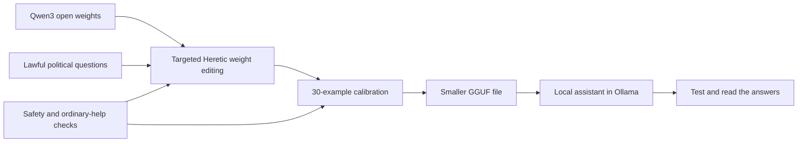

# QuiLLM

**A small local AI that answers lawful political questions more directly.**

QuiLLM is a Qwen3 experiment from [Lore Hex](https://github.com/Lore-Hex), built
for QuillOS. We wanted a computer's local
assistant to discuss history and politics without canned state-aligned answers,
while retaining refusals for requests that could hurt people.

This repository opens the method, the custom data, the saved search trials, and
the model files. You can inspect what happened, run the model, or ask your coding
agent to rebuild it. You do not need a TrustedRouter account or an API key.

## Start Here

- **Just use it:** [download and run a released model](docs/REPRODUCE.md#run-the-existing-model).
- **Understand it:** [the method in ordinary language](docs/METHOD.md).
- **Check the evidence:** [results and limitations](docs/RESULTS.md), [all 151 trials](reports/optimizer-trials.csv).
- **Make it again:** [step-by-step reproduction](docs/REPRODUCE.md).

Paste this into your agent:

> Read https://github.com/Lore-Hex/QuiLLM and its AGENTS.md. Explain how QuiLLM was
> made in plain language. Check the published data locally, then help me run the
> 4B model. Show me its actual answers and limitations. If I want to train it,
> use the saved-trial recipe first and check my hardware before starting. Keep
> the safety calibration and tests. Label regression probes separately from
> independent evaluations.

## What We Changed

We started with Qwen's existing open weights. We did **not** train a new language
model from scratch, add a hidden cloud service, or simply filter its answers.



1. Compare how the model responds internally to two sets of lawful questions.
2. Use [Heretic](https://github.com/p-e-w/heretic) to find a small weight change
   that reduces political refusals while limiting changes on other prompts.
3. Fine-tune with 30 examples: factual political answers, explicit safety
   refusals, and a normal troubleshooting answer.
4. Compress the model for local use with [llama.cpp](https://github.com/ggml-org/llama.cpp).
5. Test the compressed model, not just the training checkpoint.

## The Models

| Model | Base | Selected search trial | Calibration | Local file |
|---|---|---:|---:|---:|
| QuiLLMv1 1.7B | Qwen3-1.7B | 80 | 4 epochs | 1.26 GB, Q5_K_M |
| QuiLLMv1 4B | Qwen3-4B | 4 | 8 epochs | 2.50 GB, Q4_K_M |

Epoch counts are recorded in the archived artifact names; the original SFT loss
logs were not recovered. Sizes are decimal GB. [Provenance and weight hashes](models/provenance.json).

## What the Saved Results Show

The optimizer evaluated a **12-question set used during tuning**:

| Variant | Base flagged responses | Selected trial flagged responses | KL divergence | Completed trials |
|---|---:|---:|---:|---:|
| 1.7B | 5 / 12 | 2 / 12 | 0.000875 | 100 |
| 4B | 2 / 12 | 1 / 12 | 0.000144 | 51 |

These are the saved **pre-calibration, pre-quantization** results. A flagged
response is a keyword heuristic, not a factuality verdict. KL divergence measures
how much the model's predictions changed on the preservation prompts; it does
not prove safety or unchanged general ability.

**Important:** all eight original political regression questions also appear
verbatim in calibration. Their scores are useful for checking the build, not
for claiming generalization. A fresh 4B check passed 7/8 original political
checks and 8/8 original safety checks. New questions exposed factual errors
despite passing the keyword scorer. [Read the complete results and actual answers](docs/RESULTS.md).

## What Is Included

- 40 targeted questions and 40 comparison questions for the weight-editing step.
- 12 optimizer-evaluation questions and 18 behavior-preservation questions.
- All 30 supervised calibration examples.
- Original 8-question political and 8-question safety probes.
- A new 8-question recovery check, fixed before the release-time inference run.
- Complete nonempty optimizer journals, selected parameters, and a CSV of every completed trial.
- Original scripts alongside documented portability fixes, dependency versions,
  base-model revision metadata, deployment templates, and checksums.
- Released GGUF weights in GitHub release assets, split into verified parts.

To recalculate the reports without a GPU or any installation:

```bash
python3 scripts/summarize.py --check
python3 -m unittest discover -s tests -v
```

## Limits and License

This is a small research release, not a generally validated or guaranteed-safe
assistant. Read [limitations](docs/LIMITATIONS.md) before using it. There is no
independent large-scale benchmark or claim of frontier-model quality.

Repository code is **AGPL-3.0-or-later**. The custom prompt data is offered under
the same repository license. Qwen base and derived model weights retain their
**Apache-2.0** obligations. Other tools retain their own licenses.
[Licensing and attribution](docs/ATTRIBUTION.md).
